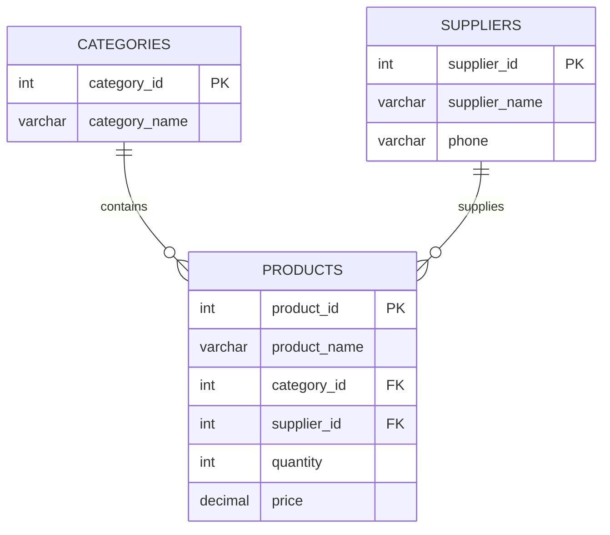

# UNIVERSITY CSE DBMS LAB PROJECT REPORT
## Simple Inventory Management System

---

**Project Title:** Simple Inventory Management System  
**Course:** Database Management Systems (DBMS) Laboratory  
**Department:** Computer Science and Engineering (CSE)  
**Student Name:** [Your Name]  
**Student ID:** [Your Student ID]  
**Semester / Section:** [Your Semester & Section]  
**Submission Date:** November 2026  

---

## 1. Project Overview & Objectives

### 1.1 Introduction
Effective inventory tracking is critical for retail shops to monitor stock levels, prevent stockouts, and evaluate business assets. The **Simple Inventory Management System** is a lightweight, responsive, single-page web application designed for small retail stores. It allows store managers to track products, categorize inventory, record supplier information, and calculate live stock valuations.

### 1.2 Key Objectives
- Maintain a structured relational database using **MySQL**.
- Implement full **CRUD (Create, Read, Update, Delete)** functionality.
- Provide real-time stock and valuation metrics using **SQL aggregate functions**.
- Ensure a fast, seamless user experience on a single page using **JavaScript Fetch API** without full-page reloads.
- Protect database integrity using **Primary Keys**, **Foreign Keys**, and **Prepared Statements**.

---

## 2. Technology Stack & System Architecture

| Layer | Technology | Purpose |
|---|---|---|
| **Frontend** | HTML5, CSS3, JavaScript (ES6) | Responsive UI, single-page dashboard, Fetch API asynchronous communication |
| **Application Server** | Apache Tomcat 10.1 | Web container hosting Java Servlets |
| **Backend Language** | Java (JDK 23) | Business logic and HTTP request handling |
| **Database Connectivity** | JDBC (`mysql-connector-j-8.4.0.jar`) | Database driver providing Java-to-MySQL connection |
| **Database Engine** | MySQL 8.0 Server | Relational database storage and query execution |
| **Database Administration** | MySQL Workbench 8.0 CE | Schema design, table management, and SQL execution |
| **Development IDE** | Eclipse IDE for Enterprise Java | Code authoring, debugging, and Tomcat integration |

### 2.1 Architecture Diagram
```
+-------------------------------------------------------------+
|                      Client Web Browser                     |
|           (index.html, style.css, JavaScript app.js)        |
+-------------------------------------------------------------+
                              ▲  │
       JSON Data via Fetch()  │  │  HTTP Requests (GET, POST, DELETE)
                              │  ▼
+-------------------------------------------------------------+
|                     Apache Tomcat 10.1                      |
|  +------------------------+      +------------------------+ |
|  |     ProductServlet     |      |     SummaryServlet     | |
|  +------------------------+      +------------------------+ |
|                              ▲                              |
|                              │ DBConnection (JDBC Driver)   |
|                              ▼                              |
|                   MySQL 8.0 Database Server                 |
|             (Database: inventory_management)                |
|       - categories    - suppliers    - products             |
+-------------------------------------------------------------+
```

---

## 3. Database Design & Relational Schema

The database `inventory_management` is normalized up to Third Normal Form (3NF) to eliminate data redundancy and ensure referential integrity.

### 3.1 Entity Relationship (ER) Diagram



### 3.2 Relational Schema Specifications

#### 1. `categories` Table
Stores product classifications.
- `category_id` (INT, PRIMARY KEY, AUTO_INCREMENT): Unique identifier for each category.
- `category_name` (VARCHAR(100), NOT NULL): Name of the category.

#### 2. `suppliers` Table
Stores contact details for distributors and manufacturers.
- `supplier_id` (INT, PRIMARY KEY, AUTO_INCREMENT): Unique identifier for each supplier.
- `supplier_name` (VARCHAR(100), NOT NULL): Registered supplier/company name.
- `phone` (VARCHAR(20), NOT NULL): Contact phone number.

#### 3. `products` Table (Master Table)
Stores inventory items linked to categories and suppliers.
- `product_id` (INT, PRIMARY KEY, AUTO_INCREMENT): Unique identifier for each product.
- `product_name` (VARCHAR(150), NOT NULL): Title/description of the product.
- `category_id` (INT, FOREIGN KEY): References `categories(category_id)`.
- `supplier_id` (INT, FOREIGN KEY): References `suppliers(supplier_id)`.
- `quantity` (INT, DEFAULT 0): Available stock count.
- `price` (DECIMAL(10,2), DEFAULT 0.00): Unit selling price.

### 3.3 Referential Integrity Constraints
```sql
CONSTRAINT fk_products_categories
    FOREIGN KEY (category_id) REFERENCES categories(category_id)
    ON DELETE SET NULL ON UPDATE CASCADE,
CONSTRAINT fk_products_suppliers
    FOREIGN KEY (supplier_id) REFERENCES suppliers(supplier_id)
    ON DELETE SET NULL ON UPDATE CASCADE
```
- **`ON UPDATE CASCADE`**: If a `category_id` or `supplier_id` is updated, the child records in `products` automatically update.
- **`ON DELETE SET NULL`**: If a category or supplier is removed, existing products remain in the catalog with category/supplier set to `NULL` to avoid orphaned records or data loss.

---

## 4. Key Implementation Details & SQL Queries

### 4.1 SQL Aggregate Functions (Dashboard Summary Cards)
The summary metrics are computed directly by the database using SQL aggregate functions:
```sql
SELECT 
    COUNT(*) AS total_products, 
    COALESCE(SUM(quantity), 0) AS total_quantity, 
    COALESCE(SUM(quantity * price), 0) AS total_value 
FROM products;
```
- `COUNT(*)` calculates total unique inventory items.
- `SUM(quantity)` aggregates overall stock count across all products.
- `SUM(quantity * price)` multiplies individual item counts by price to provide storewide inventory valuation.
- `COALESCE(..., 0)` guarantees that an empty table returns `0` instead of SQL `NULL`.

### 4.2 Multi-Table Joins (`LEFT JOIN`)
To display human-readable category and supplier names instead of raw numeric IDs:
```sql
SELECT 
    p.product_id, 
    p.product_name, 
    c.category_name, 
    s.supplier_name, 
    p.quantity, 
    p.price, 
    (p.quantity * p.price) AS total_value
FROM products p
LEFT JOIN categories c ON p.category_id = c.category_id
LEFT JOIN suppliers s ON p.supplier_id = s.supplier_id
ORDER BY p.product_id ASC;
```

### 4.3 Pattern Matching & Search (`LIKE` Operator)
Real-time filtering uses the SQL `LIKE` clause with `%` wildcards:
```sql
WHERE p.product_name LIKE ?
-- Parameter bound safely: "%" + keyword + "%"
```

### 4.4 Data Security via `PreparedStatement`
All `INSERT`, `UPDATE`, and `DELETE` operations use parameterized SQL queries:
```java
String sql = "INSERT INTO products (product_name, category_id, supplier_id, quantity, price) VALUES (?, ?, ?, ?, ?)";
PreparedStatement stmt = conn.prepareStatement(sql);
stmt.setString(1, productName);
stmt.setInt(2, categoryId);
stmt.setInt(3, supplierId);
stmt.setInt(4, quantity);
stmt.setDouble(5, price);
stmt.executeUpdate();
```
*Benefit:* Prevents **SQL Injection** by treating all user input strictly as literal values rather than executable SQL statements.

---

## 5. Testing & Verification Results

The application underwent rigorous verification with the following results:

| Feature Tested | Test Action | Expected Result | Status |
|---|---|---|:---:|
| **Initial Load** | Open `http://localhost:8080/InventorySystem1/` | Table displays 10 products; summary cards show accurate totals | **PASS** |
| **Add Product** | Submit new product details | Row inserted into MySQL; table updates; summary counts increment | **PASS** |
| **Real-Time Search** | Type keyword in search box | Table dynamically filters rows using `LIKE %keyword%` | **PASS** |
| **Edit Mode** | Click "Edit" on a product row | Form pre-populates with data; changes to "Update Product" mode | **PASS** |
| **Update Product** | Submit modified price and quantity | Database row updated; table and total inventory value recalculate | **PASS** |
| **Cancel Edit** | Click "Cancel" while in edit mode | Form clears and resets safely to "Add New Product" mode | **PASS** |
| **Delete Product** | Click "Delete" and accept confirmation | Row removed from database; table re-renders; cards decrement | **PASS** |
| **SQL Injection Test** | Input `' OR '1'='1` in inputs | Handled as plain text; database remains secure | **PASS** |

---

## 6. Viva / Lab Evaluation Q&A Preparation

### Q1: Why did you choose JDBC instead of an ORM like Hibernate?
> **Answer:** JDBC is the core low-level API provided by Java for database communication. For this project, JDBC gives us direct control over raw SQL execution, allows explicit understanding of connections, transactions, and statements, and eliminates the overhead and complex configuration of heavy ORM frameworks.

### Q2: What is the purpose of `Class.forName("com.mysql.cj.jdbc.Driver")`?
> **Answer:** It dynamically loads and registers the MySQL JDBC Driver class into Java's `DriverManager` memory at runtime so the application can locate and communicate with MySQL.

### Q3: Why is `PreparedStatement` preferred over standard `Statement`?
> **Answer:**
> 1. **Security:** `PreparedStatement` prevents SQL Injection by pre-compiling the SQL statement and sanitizing input parameters.
> 2. **Performance:** The database compiles the SQL statement once, caching the execution plan for repeated queries with varying parameters.

### Q4: Why did you use `LEFT JOIN` instead of `INNER JOIN` in the product queries?
> **Answer:** If a product does not have an assigned category or supplier (e.g. if a category was deleted and the foreign key became `NULL`), an `INNER JOIN` would completely hide that product from the list. A `LEFT JOIN` ensures all products are displayed even if their category or supplier is `NULL`.

### Q5: What does `COALESCE(SUM(quantity), 0)` do?
> **Answer:** If a table contains no matching rows, the SQL `SUM()` function evaluates to `NULL`. `COALESCE()` returns the first non-null argument in its list, converting `NULL` into `0` to prevent `NullPointerException` or formatting issues in the backend.

### Q6: How does the application update without refreshing the browser page?
> **Answer:** The frontend uses the JavaScript `Fetch API` to send asynchronous HTTP requests (`GET`, `POST`, `DELETE`) to the Java Servlets in the background. The Servlets return lightweight JSON responses, and JavaScript dynamically updates the Document Object Model (DOM) table rows and summary text.

---

## 7. Conclusion

The Simple Inventory Management System successfully demonstrates end-to-end relational database integration using Java Servlets, JDBC, and MySQL. It fulfills all course requirements by combining a normalized database schema, secure parameterized queries, SQL aggregate operations, and a clean single-page user interface.
